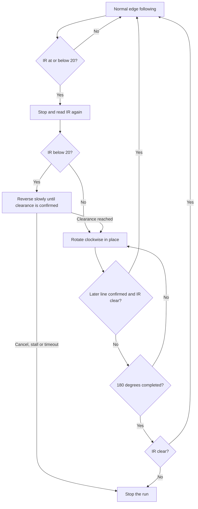

# GPT_BOTA_V2 — EV3 edge follower

This project runs a tracked EV3 robot along the edge of white tape on a black
surface. It uses a small Q-table to select line-following actions, plus a
separate rule-based obstacle routine: reverse for clearance if necessary, then
rotate clockwise up to 180°, stopping early if a line is detected after leaving
the starting line.

This README describes the current `edge_following-RL.py`. The project originated
from `kaveeshanirmal/cognitive-robotics`; the scripts in `development/` are
reference and diagnostic files, not the active controller.

## Files and runtime

```text
GPT_BOTA_V2/
├── edge_following-RL.py   # Active controller
├── edge_q_table.json     # Working 3 × 4 Q-table
├── README.md             # This guide
└── development/          # Older controllers, alternate tables and diagnostics
```

Only the Python script and `edge_q_table.json` are required on the robot for a
normal run. Training creates an additional checkpoint file. The controller uses
**Python 3 with ev3dev2 on ev3dev**, not Pybricks MicroPython. It imports standard
Python modules and the installed `ev3dev2` hardware library; it does not import
anything from `development/`.

## Hardware configuration

| Device | Current port |
| --- | --- |
| Left track motor | D |
| Right track motor | A |
| Color sensor | S2 |
| Infrared sensor | S4 |

Ports are set in `initialize_hardware()`. The color sensor uses reflected-light
mode (`COL-REFLECT`). The configured motor signs assume positive commands move
the robot forward. Preserve the assignments that work on this robot.

For obstacle turns, the code uses a **20 mm drive-wheel diameter** and an
**effective track spacing of 101.25 mm**. Effective spacing is an empirical
turning parameter, not the measured outer width of the robot. Earlier testing
with 180 mm commanded a 90° turn but produced approximately 160°; applying
`180 × 90 / 160 = 101.25 mm` produced approximately 90° on the retest. Track slip,
surface changes and loading can still affect the actual turn.

## Running on the robot

Transfer the two runtime files into `~/GPT_BOTA_V2` using your EV3 VS Code
connection. In the **robot's terminal**:

```sh
cd ~/GPT_BOTA_V2
brickrun -r -- python3 edge_following-RL.py
```

Place the sensor over the white-tape edge before launching. **Movement begins
automatically after loading the table and initializing hardware.** There is no
CENTER-to-start screen, calibration wizard or startup menu. Output appears in
the terminal. Press the EV3 CENTER button or Ctrl+C in the terminal to stop.

For a short trial:

```sh
brickrun -r -- python3 edge_following-RL.py --steps 50
```

`--steps` counts completed line-following decisions, not elapsed time or recovery
movements. With the default timing, 50 steps typically take more than five
seconds; obstacle handling adds its own time.

Relative table paths are resolved from the terminal's current directory. A
missing or invalid Q-table fails before hardware initialization. An invalid
sensor/motor port must be corrected in `initialize_hardware()` or the wiring.

## How line following works

### 1. Convert reflection into a state

`categorize_reflection()` maps the color reading into three states:

| State / Q-table row | Reflection | Meaning |
| --- | --- | --- |
| 0 | Less than 8 | Black background |
| 1 | 8 through 25 inclusive | Target edge zone |
| 2 | Greater than 25 | White tape interior |

These are fixed raw thresholds. The program does not normalize reflection or
learn calibration values. “Edge” means a reading in the middle range; it is not
an image-based estimate of the tape position.

### 2. Select an action from the Q-table

Each JSON row corresponds to a state. Its four columns are ordered as follows:

| Action / column | Meaning |
| --- | --- |
| 0 | Forward |
| 1 | Left turn |
| 2 | Right turn |
| 3 | Reverse |

In default **RUN (frozen)** mode, `select_action()` chooses the largest Q-value
in the current row. A tie selects the first matching column. The currently
supplied table chooses:

| Sensor state | Highest-valued action |
| --- | --- |
| Black | Right turn |
| Edge | Forward |
| White | Left turn |

This policy follows a particular tape-edge orientation: from black it steers
right toward tape, and from white it steers left toward black. It does not
identify which edge of the tape it is on or automatically mirror its policy.

### 3. Translate the action into motor commands

Motor values below are `SpeedPercent` commands, not distances or cm/s.

| Action | Left motor | Right motor |
| --- | --- | --- |
| Forward | +22 | +22 |
| First left turn in a sequence | +4 | +22 |
| Repeated left turn | −10 | +18 |
| First right turn in a sequence | +22 | +4 |
| Repeated right turn | +18 | −10 |
| Reverse | −20 | −20 |

Two or more consecutive selections of the same turn activate the stronger
correction. This is a heuristic based on action history; it does not measure a
corner angle. Switching turn direction starts a new sequence. Forward, reverse
and `stop_motors()` reset turn history. Normal actions do not brake after each
cycle; motor commands persist until replaced or stopped.

### 4. Hold, observe and repeat

The normal control loop checks CENTER and IR, selects an action, commands the
motors, waits, then reads reflection to obtain the next state and reward.

Default `--timing original --period-ms 100` means a full **100 ms wait after
issuing motor commands**. Sensor and motor IO add to the actual interval; the
user's earlier measurements were around 127–129 ms between commands. It is not
a guaranteed 10 Hz controller.

During the wait, CENTER is polled with sleeps of at most 10 ms and IR is normally
checked at approximately 20 ms intervals, except near the end of the wait.
Actual response includes IO and Linux scheduling time. Color is read after the
normal action wait, not continuously during that wait.

`--timing fixed` instead attempts to include processing time within the requested
period. It remains an experimental option; the original timing is the working
default. A missed full period resets the schedule to avoid rapid catch-up actions.

## Obstacle handling: clearance reverse and U-turn

This is a **rule-based override**, separate from Q-learning. It does not learn an
obstacle route, estimate obstacle width or plan arcs around the obstacle.



CENTER, a stall or timeout can also stop the turn at any point.

### Trigger and reverse clearance

Normal following triggers recovery when `IR <= OBSTACLE_THRESHOLD`, currently
**20**. IR values are relative proximity readings, not centimeters; smaller
values indicate a closer object. Do not use the approximate distance comment
in the source as a measured clearance for your obstacle.

The robot stops and rechecks IR before deciding whether to reverse:

- If the new reading is **20 or greater**, it proceeds directly to the turn.
- If the reading is **below 20**, both motors reverse at **−12 percent**.
- At the first reading of **20 or greater**, it stops reversing and checks for
  **three consecutive clear readings while stationary**.
- A reading below 20 resets confirmation and restarts reversing.

This uses measured proximity, not a fixed reverse duration or distance. The
reverse phase polls IR and CENTER with a 20 ms sleep between iterations; it does
not use color readings to terminate reversing. It stops the run if clearance
is not achieved within **6 seconds**, or either reversing motor fails to make
at least 2° of cumulative encoder progress over approximately **2 seconds**.
There is no rear obstacle sensor, so the space behind the robot must be clear.

### Encoder-guided clockwise turn

Once clearance is established, fresh encoder origins are recorded so the reverse
movement does not count toward the turn. The left motor runs forward and the
right backward, starting at **12 percent** magnitude. Encoder imbalance adjusts
the two magnitudes by up to 3 percentage points to keep their progress similar.

Each tread's target motor rotation is:

```text
motor target degrees = effective track spacing × desired heading / wheel diameter
                     = 101.25 × 180 / 20
                     = 911.25 degrees
```

This assumes the configured wheel diameter represents travel per motor rotation.
Each motor is commanded to zero when it reaches its own target. Completion
requires both targets; motors are stopped on exit. Mechanical slip means the
physical heading is approximately 180°, not independently measured.

The turn reads encoders, color, IR and CENTER throughout, with a 20 ms sleep
between iterations. It stops the run on a motor stall or a **25-second turn
timeout**. This timer starts after reversing; it is separate from the 6-second
reverse timeout. Motor commands are updated when needed, without repeated
stop–start movement between sensor checks.

A close IR reading during rotation prevents early resumption but does **not**
interrupt the turn immediately or trigger another reverse. This lets the robot
turn away from the original obstacle. At turn completion, IR must be at least
20 to resume.

### Detecting a line without immediately accepting the starting line

The turn uses this sequence:

1. Ignore departure confirmation until the encoder-estimated heading reaches
   **20°**.
2. Require **three consecutive black readings below 8** after that angle. This
   arms line reacquisition.
3. Require **three consecutive readings of 8 or greater**, each with IR at least
   20. Stop the turn early and resume line following.

Both an edge reading and full white tape qualify in step 3. A black reading or
close IR resets the line-confirmation counter. Color changes seen during the
reverse do not arm this sequence.

The message `New line detected during turn; resuming` means this sequence was
satisfied. A single color sensor cannot prove that the tape is a different
physical line: the same line encountered again after a black gap also qualifies.
Likewise, a very narrow line may pass under the sensor before three readings are
confirmed.

If no line qualifies before the full turn, the robot **still resumes when IR is
clear**, even when the color sensor is on black. The existing Q-table then
selects corrective actions. There is no separate lost-line search, edge-direction
switch or guarantee of reacquiring a suitable tape edge after the U-turn.

The same IR value of 20 is accepted as clearance during recovery and triggers
recovery in normal following. A reading that stays exactly at 20 after resumption
can therefore trigger another recovery; there is no separate hysteresis band.

## Training and persistence

A normal run uses the saved policy without updating or saving its Q-values.
Rewards are still calculated for diagnostics. Changing obstacle-recovery settings
does **not** require retraining the Q-table.

To explicitly train:

```sh
brickrun -r -- python3 edge_following-RL.py --train --steps 500
```

This loads `edge_q_table_training.json` if that checkpoint already exists;
otherwise it starts from `edge_q_table.json`. Default training exploration is
zero, so it updates values for greedy actions. To allow exploratory actions:

```sh
brickrun -r -- python3 edge_following-RL.py --train --epsilon 0.12 --steps 500
```

Here each selection has a 12% chance of choosing one of the four actions randomly,
including reverse. A checkpoint uses the same 3 × 4 JSON format as the baseline.
To evaluate the candidate without updating it:

```sh
brickrun -r -- python3 edge_following-RL.py --table edge_q_table_training.json
```

Training applies the Q-learning update only after a completed normal action:

```text
Q[state, action] += 0.25 × (
    reward + 0.9 × max(Q[next_state]) − Q[state, action]
)
```

The learning rate is `alpha = 0.25`; future reward discount is `gamma = 0.9`.
Actions interrupted by an obstacle or CENTER do not produce an update. Reverse
clearance and obstacle turns are never training transitions.

### Reward rules

Conditions in each next-state group are evaluated from top to bottom:

| Next state | First matching condition | Reward |
| --- | --- | --- |
| Edge | Forward | +10 |
| Edge | Either turn | +8 |
| Edge | Reverse | −5 |
| Black | Forward | −10 |
| Black | Previous state was edge | −8 |
| Black | Right turn | +7 |
| Black | Otherwise | −6 |
| White | Previous state was edge | −2 |
| White | Left turn | +7 |
| White | Otherwise | +1 |

These rules favor one edge orientation. A positive reward does not prove forward
progress: turning right while remaining on black can receive +7. Action-history
turn strength is also absent from the three-state representation.

After at least one completed training step, the checkpoint is written when the
program exits through its cleanup handler, including CENTER, Ctrl+C or recovery
failure. There is **no periodic checkpoint during a run**, and writing the file
is not atomic. Power loss can lose unsaved training or interrupt a save. Wait for
the save message before transferring the checkpoint. The default baseline is
not overwritten; using the same input and training-output path is rejected.

## Calibration and settings

### Check reflection on your surface

Keep the sensor at its normal mounted height and measure black background,
tape edge and white tape under the lighting you will use. For live readings,
optionally transfer the diagnostic and run from the robot project directory:

```sh
brickrun -r -- python3 development/check_color_sensor.py
```

The diagnostic scans for a color sensor, prints readings and exits with Ctrl+C.
It does not move motors or save calibration. Check that black normally reads
below 8, the desired edge lies between 8 and 25, and white is above 25.

If readings require different thresholds, edit `categorize_reflection()` and
keep the hard-coded black/tape boundary in `avoid_obstacle_and_find_path()`
consistent. Update the diagnostic's labels if needed. Changing state boundaries
changes which Q-table row is used, so re-evaluate the working policy afterward.

### Tune proximity and movement

Measure IR on S4 against the actual obstacle at a clearance that permits the
whole body to rotate. Set `OBSTACLE_THRESHOLD` to the corresponding reading.
Do not assume 20 means 20 cm or a fixed physical distance across objects.
The old `development/check_sensors.py` tests IR on S3 and must be adapted before
using it to inspect this robot's S4 sensor.

| Setting | Current value | Effect |
| --- | --- | --- |
| `BASE_SPEED` | 22 | Forward and first-turn outer motor speed |
| `--period-ms` | 100 | Normal action hold duration |
| `OBSTACLE_THRESHOLD` | 20 | Obstacle trigger and reverse-clearance boundary |
| `REVERSE_CLEARANCE_SPEED` | 12 | Clearance reverse speed magnitude |
| `REVERSE_CLEARANCE_TIMEOUT_SECONDS` | 6 | Maximum clearance-reverse phase time |
| `REVERSE_CLEAR_SAMPLES` | 3 | Stationary clearance confirmation count |
| `TURN_SPEED` | 12 | Base U-turn motor speed magnitude |
| `TURN_TRACK_MM` | 101.25 | Effective spacing used for heading calculation |
| `TURN_WHEEL_DIAMETER_MM` | 20 | Travel-per-rotation geometry parameter |
| `TURN_IGNORE_DEGREES` | 20 | Minimum angle before departure can be confirmed |
| `TURN_CONFIRM_SAMPLES` | 3 | Both black-departure and later-line confirmation count |
| `TURN_STALL_SECONDS` | 2 | Stall interval for either motor in reverse or turn |
| `RECOVERY_TIMEOUT_SECONDS` | 25 | Turn timeout, excluding reverse phase |

Increasing the IR threshold normally asks for more clearance; decreasing it
allows a closer obstacle before recovery. IR measures the front sensor's view,
not the robot's swept body clearance. Neither sensor detects obstacles behind
the robot or guarantees protection from a table edge.

For a measured heading error, the effective-track correction is:

```text
new effective track = current effective track × commanded angle / measured angle
```

The current script has no dedicated turn-test command. Verify changes in a
controlled physical trial; do not use geometry values merely to shorten a turn
while still treating its estimate as an accurate 180°.

## Command-line options

| Option | Default | Purpose |
| --- | --- | --- |
| `--train` | Off | Enable Q-value updates and checkpoint saving |
| `--table PATH` | `edge_q_table.json` | Baseline/run input table |
| `--training-table PATH` | `edge_q_table_training.json` | Resume/save training checkpoint |
| `--epsilon VALUE` | 0 | Exploration probability; nonzero requires `--train` |
| `--timing original\|fixed` | `original` | Post-command hold or experimental fixed period |
| `--period-ms VALUE` | 100 | Positive finite hold/period in milliseconds |
| `--steps COUNT` | 0 | Completed normal steps before stopping; 0 is unlimited |

For a fresh training experiment, choose a new, nonexistent `--training-table`
path. An existing training checkpoint takes precedence over `--table` during
training.

## Logs and troubleshooting

| Output | Meaning |
| --- | --- |
| `[mode] RUN (frozen)` | Q-values are not being updated |
| `New line detected during turn; resuming` | Departure and later tape were confirmed with clear IR |
| `180-degree turn complete; resuming` | Both encoder targets reached and IR clear; line detection is not implied |
| `Obstacle still ahead after turn; stopped` | Final IR reading was below threshold |
| `Reverse clearance timeout; stopped` | Clearance not confirmed within six seconds |
| `Reverse motor stalled; stopped` / `Turn motor stalled; stopped` | At least one motor lacked sufficient encoder progress |
| `turn timeout` | Turn exceeded 25 seconds |
| `CENTER stop` | Recovery was cancelled with the brick button |

After stopping, `[timing]` reports completed normal-cycle durations and intervals
between commands. Recovery time is excluded. In original timing mode,
`deadline_overruns=0` does not imply cycles are exactly 100 ms; deadline misses
are tracked only for fixed timing.

The trace buffers one transition per five completed steps, up to 200 samples,
and prints them after stopping. `state` is the pre-action state; `reflection`
is the post-action reading used for the reward. A forward action chosen on the
edge can therefore appear beside a black reading in the same trace entry.

No startup output usually calls for checking the robot terminal and launch
command. This script has no EV3 screen UI. Incorrect ports produce initialization
errors; missing tables require checking the current directory. Persistent
oscillation or failure to follow after a U-turn may reflect the opposite tape
edge, unsuitable reflection thresholds, action strength or hold duration; the
controller does not automatically diagnose these conditions.

## Local validation and limits

The current implementation was checked with 16 hardware-stub tests for turn and
reverse behavior, plus nine applicable controller regression checks. They cover
initial-line exclusion, early tape detection, 180° encoder completion, reverse
clearance confirmation, cancellation, stalls, timeout, sensor errors, frozen
policy behavior, training and timing. These are simulated IO checks, not proof
of real clearance, traction or reliable tape reacquisition.

From the parent workspace on the computer:

```sh
python3 -B -m unittest discover -s development/tests -p test_v2_obstacle_uturn.py -v
```

This test directory is the **parent workspace's** `development/tests`, not
`GPT_BOTA_V2/development`. It need not be transferred to the EV3. The older
`test_v2_modes_timing.py` also contains recovery tests for versions that were
rolled back, so its entire suite does not target this controller.

Physical trials are still required for the current reverse-and-turn behavior.
The implementation is a small learned edge policy with hand-written recovery,
not a navigation map, route planner, line-identity recognizer or learned
obstacle-avoidance policy.
